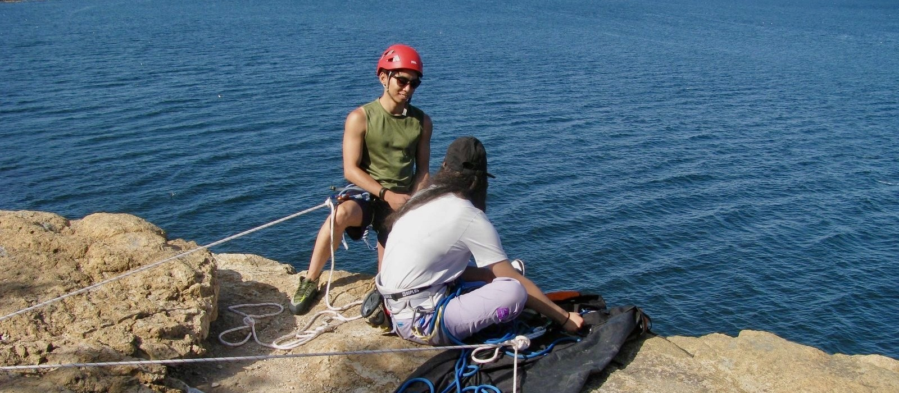

<p align="center">
  
</p>

<h1 align="center">CodClimb Product Documentation</h1>

<p align="center"><strong>User Guide &amp; Technical Reference</strong></p>

<p align="center"><em>A guide to climbing conditions, scoring methodology, and application features.</em></p>

<p align="center">
  
</p>

| Version | Published | Author | Applies to |
|:--|:--|:--|:--|
| 1.0 | November 2026 | Frank Li | CodClimb 1.4.24 · iOS 17+ · Android 7.0+ |

---

## Table of Contents

- **[01 Product Overview](#01-product-overview)** — what CodClimb is, who it serves, and what it does
- **[02 System Architecture](#02-system-architecture)** — components, data flow, alert delivery, and security
- **[03 Climbability Scoring Methodology](#03-climbability-scoring-methodology)** — how a 0–100 score is built and how to read it
- **[04 Application User Guide](#04-application-user-guide)** — task-by-task instructions
- **[05 Notifications and Alerts](#05-notifications-and-alerts)** — alert types, setup, and delivery
- **[06 Troubleshooting](#06-troubleshooting)** — symptoms, causes, and fixes
- **[07 Limitations and Safety](#07-limitations-and-safety)** — what the score cannot tell you

---

## 01 Product Overview

CodClimb is a free mobile app that answers one question for climbers: *is this crag worth the drive today?* It turns live and forecast weather into a single 0–100 climbability score for each crag, then shows the reasoning behind that number (temperature, dryness, humidity, wind, and cloud cover) hour by hour and across the week.

Route databases tell you what to climb. CodClimb tells you whether the rock is in climbing condition right now, and when it will be.

> **Important** — The score is a weather-based estimate, not advice to climb. Read [07 Limitations and Safety](#07-limitations-and-safety) before relying on it.

### The problem it solves

A generic forecast says whether it will rain. It does not say whether the rock is dry, how long it takes to dry after a storm, or whether one crag is a better bet than the one down the road. CodClimb combines weather inputs with crag-specific context, such as rock type, and presents the result as a score, a verdict, and a breakdown the climber can inspect.

### Key capabilities

| Capability | What it does |
|:--|:--|
| **Climbability score** | A live 0–100 score for each crag, with a plain-language verdict and a factor-by-factor breakdown |
| **Forecasts** | An hourly meteogram, a 7-day outlook, and the best 2-hour window in the next 48 hours |
| **Rain and drying** | Hours until the next rain, and a drying countdown after it |
| **Explore and Map** | Crags ranked by score or distance, and score-colored pins on a map, filterable by discipline and rock type |
| **Compare** | Two or three crags side by side across the week |
| **Any spot** | Weather for any location, and a way to suggest a spot as a new crag |
| **Trip planner and alerts** | Weekend ranking of saved crags, score alerts, pre-trip briefings, and rain heads-ups |
| **Community** | Condition reports with photos, comments, and reactions from other climbers |
| **Custom scoring** | Adjustable factor weights and an ideal temperature range |
| **CodClimb Snow** | A second mode in the same app that scores ski resorts |

### Platforms and access

CodClimb runs on iPhone (iOS 17 or later) and Android (7.0 or later). It is free, with no subscription, ads, or tracking.

| Access level | What you can do |
|:--|:--|
| **Guest** (no account) | Browse scores, forecasts, and the map; read a preview of five community reports; use CodClimb Snow |
| **Signed in** | Everything above, plus favorites, the trip planner, score alerts, posting, comments, reactions, and a public profile |

Sign-in methods are email and password, Google, and Sign in with Apple on iOS.

### Data sources

| Source | Used for |
|:--|:--|
| **Open-Meteo** | Hourly forecast data (temperature, precipitation, humidity, wind, cloud cover) and air quality. Weather data by [Open-Meteo](https://open-meteo.com) |
| **Curated crag catalog** | Location, rock type, and disciplines for each crag. Climbers can suggest additions, which are reviewed before they are added |
| **Community reports** | First-hand observations: how wet the rock is, how busy it is, and photos from the day |

### Scope of this document

This document covers the climbing side of the app. CodClimb Snow, the ski mode that shares the same app, is mentioned only where it shares infrastructure or alerts. It documents version 1.4.24.

---

## 02 System Architecture

CodClimb is a client-heavy design. The apps fetch the forecast and compute each score on the device. A Firebase backend handles accounts, community content, and the scheduled jobs behind trip and powder alerts.

### System context

```text
  ┌──────────────────────────────────────────────────────────────────┐
  │                           CLIENT APPS                            │
  │                                                                  │
  │ iOS · Swift / SwiftUI                  Android · Kotlin          │
  │ Explore · Map · Favorites · Community · Profile                  │
  │                                                                  │
  │ On device: scoring engine · weather cache · score alerts         │
  └──────────────┬────────────────────────────┬──────────────────────┘
                 │                            │
                 │ hourly forecast            │ accounts · reports
                 │                            │ trips · photos
                 │                            │
                 ▼                            ▼
  ┌──────────────────────────────┐    ┌──────────────────────────────┐
  │          OPEN-METEO          │    │           FIREBASE           │
  │ forecast + air quality       │◄───│ Authentication               │
  │ free · no API key            │    │ Cloud Firestore              │
  └──────────────────────────────┘    │ Cloud Storage                │
                                      │ Cloud Functions              │
                                      └───────┬──────────────────────┘
                                              │
                                              │ scheduled jobs
                                              │
                                              ▼
                                      ┌──────────────────────────────┐
                                      │ Push · FCM + APNs            │
                                      │ Email · Brevo SMTP           │
                                      └──────────────────────────────┘
```

1. The apps request hourly forecasts directly from Open-Meteo and compute the score on the device.
2. The apps read and write community data, profiles, trips, and photos through Firebase.
3. Cloud Functions also fetch the forecast (the arrow between the two boxes), so they can evaluate armed trips and powder watches on a schedule.
4. Alerts leave Firebase through Firebase Cloud Messaging (FCM) and Apple Push Notification service (APNs). Account emails go out through an SMTP relay.

### Components

| Layer | Technology | Responsibility |
|:--|:--|:--|
| **iOS app** | Swift, SwiftUI (iOS 17+) | Interface, on-device scoring, weather cache, score alerts, map |
| **Android app** | Kotlin (Android 7.0+) | Feature parity with the iOS app |
| **Weather** | Open-Meteo forecast and air-quality APIs | Hourly forecast data. Free, and no API key required |
| **Accounts** | Firebase Authentication | Email and password, Google, and Apple sign-in, plus anonymous sessions for guests |
| **Database** | Cloud Firestore | Community reports, profiles, trips, and moderation data |
| **File storage** | Cloud Storage for Firebase | Report photos, avatars, and cover images |
| **Server logic** | Cloud Functions | Scheduled alert jobs, comment notifications, and moderation triggers |
| **Push** | FCM and APNs | Delivery of trip, rain, powder, and comment notifications |
| **Email** | SMTP relay (Brevo) | Verification and password-reset messages |
| **Maps** | MapKit (iOS) | Map and score-colored pins |

### Score request lifecycle

1. The app loads its crag catalog: a curated list bundled with the app, plus crags promoted from community suggestions.
2. It requests the hourly forecast for the crag's coordinates from Open-Meteo. Responses are cached on the device for 30 minutes, so reopening a crag within that window does not trigger a new request.
3. The on-device scoring engine turns the forecast into a score and a verdict (see [03 Climbability Scoring Methodology](#03-climbability-scoring-methodology)).
4. The interface renders the score, the verdict, the hourly strip, and the 7-day outlook.

### Alert delivery

Alerts reach the phone by two paths.

**Score alerts run on the device.** On iOS, the app uses background tasks to check your saved crags and posts a local notification when a crag reaches the threshold you set. iOS decides when background tasks run, so timing is best-effort.

**Trip and powder alerts run on the server.** The delivery chain is:

1. When the user arms a trip, the device registers for push notifications so the server can reach it.
2. A scheduled Cloud Function reads armed trips (or powder watches) from Firestore.
3. The function fetches the forecast from Open-Meteo and decides whether an alert is due.
4. FCM hands the message to APNs, which delivers it to the phone.

| Job | Schedule | Purpose |
|:--|:--|:--|
| Rain nowcast | Every 15 minutes | Warns when rain is moving in during an armed trip window |
| Pre-trip briefing | Evening before the trip (about 6 PM ET) | Summarizes the next day's conditions |
| Morning update | Morning of the trip (about 6 AM ET) | Refreshes the briefing with that morning's forecast |
| Powder alerts | Twice daily (6 AM and 5 PM ET) | Notifies when forecast new snow reaches a user's target (Snow mode) |

### Data model

| Data | Contents |
|:--|:--|
| **Condition reports** | Community condition reports and their comments |
| **User profiles** | Display name, avatar, bio, climbing styles, and report statistics |
| **Trips** | Armed trips: crag or point, dates, and time window |
| **Powder watches** | Powder-alert watches for Snow mode |
| **Crag suggestions** | The pipeline from a climber's suggestion, through review, to a crag available to everyone |
| **Moderation** | Reported content and suspended accounts |
| **Feedback** | In-app bug reports, feature requests, and content reports |

Records are stored in Cloud Firestore. Photos (avatars, cover images, and report photos) are stored in Cloud Storage.

### Security and moderation

- **Authentication.** Firebase Authentication issues the identity for every session. Guests get an anonymous session, so browsing needs no account.
- **Security rules.** Firestore and Storage rules restrict writes to the owner of the data (for example, profile writes and comment deletion). The rules have an automated emulator test suite that must pass before a change is published.
- **Moderation.** Sign-up requires accepting the terms. Any post can be flagged, and any user can be blocked or reported. A post is hidden automatically once the community reports it, and reports are reviewed within 24 hours.

### Resilience and performance

- Weather responses are cached on the device for 30 minutes.
- Open-Meteo is a free, shared service with usage limits. In the Snow charts, the app tells you when the service is busy and fills in on its own once it recovers, rather than stalling on "Loading".

---

## 03 Climbability Scoring Methodology

### What the score represents

The climbability score is an informational estimate of how good the weather conditions are for climbing at a crag. It answers *how good are conditions?* It does not answer *is it safe to climb?*

This section describes how the score is structured and how to read it. It deliberately stops short of the exact formulas.

### How a score is built

```text
  Hourly forecast: temperature · rain · humidity · wind · cloud
        │
        ▼
  ┌──────────────────────┐
  │ 1  Factor sub-scores │   each factor graded on its own
  └─────┬────────────────┘
        │
        ▼
  ┌──────────────────────┐
  │ 2  Weighted blend    │   default weights; adjustable by the user
  └─────┬────────────────┘
        │
        ▼
  ┌──────────────────────┐
  │ 3  Condition gates   │   snow cover or frozen rock overrides the blend
  └─────┬────────────────┘
        │
        ▼
  ┌──────────────────────┐
  │ 4  Score + verdict   │   plain-language verdict and factor breakdown
  └──────────────────────┘
```

1. **Factor sub-scores.** Each of five factors is graded on its own against the forecast for that hour.
2. **Weighted blend.** The factors are combined using weights. The defaults are listed below, and every climber can change them.
3. **Condition gates.** Some questions are not about how *good* conditions are but whether the rock can be climbed at all, such as a crag buried in snow or frozen solid. These are applied as gates that multiply the blended score, so strong results on the other factors cannot outvote them. When a gate is active, the verdict says why.
4. **Score and verdict.** The result is a 0–100 score, a plain-language verdict, and a breakdown showing what helped and what held it back.

### The five factors

| Factor | Default weight | What it captures |
|:--|:--:|:--|
| **Temperature** | 30% | Air temperature relative to a comfortable climbing range |
| **Dryness** | 25% | Time since the last measurable rain, adjusted for rock type |
| **Humidity** | 20% | Moisture in the air, which affects friction and drying |
| **Wind** | 15% | A light breeze scores best; strong gusts and dead calm both count against a crag |
| **Cloud cover** | 10% | Sun and cloud, interpreted using a sun-or-shade preference |

Dryness is rock-aware. Porous rock such as sandstone is given extra drying time, and the verdict can say so, for example by warning that wet sandstone is fragile.

> **Note** — Defaults are starting points. Presets for sport, trad, and bouldering shift the weights, and any factor can be adjusted. See [Customizing the score](#customizing-the-score).

### Verdicts and map colors

| Score | Verdict | What it means |
|:--:|:--|:--|
| 80–100 | **Send conditions** | The factors line up. Pack the tape |
| 60–79 | **Solid day** | Good climbing |
| 40–59 | **Marginal** | One factor is limiting, and the verdict names it |
| 0–39 | **Probably not worth it** | A rest day, or a day to train indoors. Rock-specific warnings may apply |

Map pins are colored green, amber, or red according to the score.

### Reading the breakdown

- **Tap any factor** for a plain-English explanation of how it affected the score.
- **Check the verdict's wording.** For a marginal score, it names the weakest factor.
- **Look at the hours, not only the headline.** The hourly strip and the best 2-hour window show when conditions peak.
- **Expect night to read differently.** Scores account for darkness, and after local sunset the app flags night conditions.

### Customizing the score

Everyone climbs differently, so the weights belong to the climber.

1. Open **Settings → Scoring**.
2. Choose **Customize scoring weights**.
3. Start from a preset (sport, trad, or bouldering), or adjust each factor yourself.
4. Set your ideal temperature range.
5. Make sure the weights total 100%. The app will not save custom scoring until they do.

Custom weights are stored on your device and change only your own scores.

### Time horizon and refresh

- The score is graded hour by hour, with a 48-hour meteogram and a 7-day summary.
- The best 2-hour window in the next 48 hours is called out on each crag.
- Weather data refreshes about every 30 minutes.
- Saved points (any location you save) show a longer-range weather outlook but never a climb score.

### Design principles

| Principle | In practice |
|:--|:--|
| **Explainable** | Every score can be opened up into its factors, in plain English |
| **Preconditions are gates, not weights** | Whether rock can be climbed at all is never traded off against how pleasant the weather is |
| **Missing data is not bad data** | If a weather variable is unavailable, CodClimb treats it as unknown rather than as poor conditions |
| **Only score what weather can show** | Ice climbing is not scored. Ice formation depends on freeze-thaw history, water volume, and sun exposure that weather models cannot see, and the cost of a wrong answer is a fall |

---

## 04 Application User Guide

### Getting started

1. Install CodClimb from the App Store or Google Play. It is free.
2. Open the app and choose **Climb** or **Snow**. The app gives a short tour of the mode you pick. You can switch modes later from the control at the top left.
3. Browse as a guest, or create an account with email, Google, or Apple (iOS) to unlock alerts, posting, and favorites.

| Tab | Use it to |
|:--|:--|
| **Explore** | Browse crags ranked by live score, search, and filter |
| **Map** | See every crag as a score-colored pin |
| **Favorites** | Keep saved crags, plan trips, and manage alerts |
| **Community** | Read and post condition reports |
| **Profile** | Manage your profile, badges, and settings |

In Snow mode, a **Chart** tab appears alongside these.

### Find a crag

1. Open **Explore** or **Map**.
2. Filter by discipline (sport, trad, boulder, or ice) and by rock type.
3. Sort by **Near Me** to find what is close and dry today.
4. Search by crag name or area to jump straight to it.
5. Tap a crag to open its page.

> **Note** — Ice appears as a discipline filter with conditions only. CodClimb does not score ice climbing.

### Read a crag page

A crag page is built to answer "should I go, and when?"

- **Score and verdict**, with a tappable breakdown of each factor
- **Rain warning**, showing the hours until the next precipitation
- **Drying countdown** after rain, with extra time allowed for porous rock
- **Hourly strip and meteogram**: temperature, precipitation, wind, cloud, and humidity over 48 hours
- **7-day outlook**, so you can plan the whole weekend
- **Best window**, the best 2 hours in the next 48
- **Sun and shade timing** for the crag
- **More conditions**: dew point, air quality, UV, visibility, and pressure trend

### Compare crags

1. Pick two or three crags. You can search for any crag, and you do not need to favorite it first.
2. Read their scores and weather side by side, day by day.
3. Tap a day for its details.
4. Use the hourly overlay to flip between score, temperature, rain, wind, cloud, and humidity, and find the exact window to send.

### Check any spot, or suggest a new crag

Not every crag is in CodClimb yet.

1. **Long-press the map** to drop a pin, use the center crosshair, or type a latitude and longitude.
2. Read the weather for that location. This is weather only, with no climb score.
3. **Save it** as one of your points to get the same hour-by-hour view and a longer-range outlook.
4. If the spot deserves to be a crag, tap **Suggest this spot as a crag**.

CodClimb reviews each suggestion against climbing resources for access, legality, and safety. If it checks out, it is added for everyone and you are credited by name on the crag page. If not, it stays yours as a private weather point. You can follow the status of your suggestions in Settings.

> **Important** — You are responsible for deciding whether a spot is legal to access and safe to climb. CodClimb provides weather only and does not verify access, ownership, or safety.

### Plan a trip

1. Open **Favorites** and choose to arm a trip.
2. Pick a crag, a date, and a time window. Optionally turn on rain alerts.
3. Tap **Arm Trip**.

CodClimb sends a briefing the evening before, an update the morning of, and a heads-up if rain moves in during your window. The same works for saved points, with an activity such as hiking or a photo shoot. Favorites also ranks your saved crags by their Saturday and Sunday scores.

### Tune the score to you

Follow the steps in [Customizing the score](#customizing-the-score).

### Share and read condition reports

The forecast gives you the math. Climbers give you the truth.

**Read reports** in the **Community** tab. Filter by region and by time window (7 days, 30 days, or all time). Like and comment on reports, and flag or block anything that does not belong.

**Post a report** after a session:

1. Choose the crag.
2. Record the rock condition and how busy it is.
3. Add notes or at least one photo. Up to four photos are allowed.
4. Post under your name, or post anonymously.

You can edit or delete your own reports. A crag earns a **Community Verified** badge when three or more different climbers report climbable conditions within 48 hours.

### Build your profile and connect

Your profile holds your display name, avatar, bio, and climbing styles, plus climber titles and achievement badges earned through activity. You can add Instagram and TikTok links to your profile, and share any report to Instagram or Stories as a branded card.

> **Note** — Connecting is social only. CodClimb does not verify anyone's identity, climbing ability, or safety skills, so vet any partner yourself.

---

## 05 Notifications and Alerts

CodClimb has four kinds of notification. Each one is opt-in.

### Alert types

| Alert | Fires when | You set it up by | Where it runs |
|:--|:--|:--|:--|
| **Score alert** | A saved crag's score reaches your threshold | Setting an alert on a crag: a minimum score (0–100) and the days of the week | On your device, in the background |
| **Pre-trip briefing** | The evening before, and the morning of, an armed trip | Arming a trip | Server, on a schedule |
| **Rain heads-up** | Rain is moving in during your trip window | Arming a trip with rain alerts on | Server, checked every 15 minutes |
| **Powder alert** (Snow mode) | Forecast new snow reaches your target at a starred resort | Setting an alert on a resort | Server, twice daily |
| **Comment notification** | Someone comments on your report | Posting a report | Server, when the comment is posted |

### Set up score alerts

1. Open a saved crag and set a score alert.
2. Choose the minimum score that counts as a good day for you.
3. Choose which days of the week the alert may fire, or leave every day unselected to allow all days.

### Requirements

Alerts are delivered as notifications, so all of the following must be true:

- Notifications are enabled for CodClimb **in the app**.
- Notifications are allowed for CodClimb in your phone's **Settings → Notifications**.
- **Focus or Do Not Disturb** is not silencing them.
- The phone has **service** (cellular or Wi-Fi). Server alerts are push notifications sent over the internet.

> **Important** — Alerts are best-effort. A rain heads-up can arrive late or not at all in a dead zone, in airplane mode, or when a pop-up storm forms between checks. Check the forecast before you lose signal, and trust your own eyes.

---

## 06 Troubleshooting

### For climbers

| Symptom | Likely cause | What to do |
|:--|:--|:--|
| An alert never arrives | The alert was turned off, notification permission is missing, or Focus is silencing it | Confirm the alert is still set. Allow notifications in the app and in the phone's Settings. Check Focus and Do Not Disturb |
| A rain warning came late, or not at all | No signal, or a storm formed between 15-minute checks | Check the forecast before you leave service. Rain alerts are best-effort |
| A score looks wrong for what I see | The score is a weather-model estimate. Local showers and complex terrain can differ from the forecast | Open the breakdown to see the limiting factor. Judge the rock in person, and consider posting a report |
| Scores or weather look stale or will not load | No connection, a cached response (refreshed every 30 minutes), or a busy weather service | Check your connection and pull down to refresh. If the weather service is busy, try again in a few minutes |
| My crag is not listed | CodClimb's catalog does not cover every area | Long-press the map for weather at that spot, then suggest it as a crag |
| A verification or password-reset email is missing | The message was filtered as spam, or the address was mistyped | Check spam and junk folders. For verification, tap **Resend verification email**. For a reset, request a new one. Signing in with Google or Apple needs no verification email |
| I can only see a few community reports | Guests see a five-report preview | Sign in to see the full feed and to post |
| A low score, but the crag looked fine | A low score does not close a crag. Sheltered or overhanging lines can stay dry in light rain | Read the breakdown, and use your own judgment |

### For maintainers

| Symptom | Where to look |
|:--|:--|
| Push notifications do not reach a real device | Confirm the APNs key is uploaded to Firebase, the Push Notifications and Remote notifications capabilities are on, and the device registered an FCM token. Send a test message to that token first, then force-run the scheduled job |
| Verification or reset emails do not send | Check that the SMTP relay is configured in Firebase Authentication and that the sender address is verified. If SMTP is disabled, mail comes from the default Firebase sender and often lands in spam |
| Community feed or photos will not load | Check that data exists in Firestore, that the user is signed in (guests see only a five-report preview), and that the report's photo URLs are valid |
| A rules change is ready to ship | Run the emulator test suite for Firestore and Storage rules. Publish only when every test passes |
| Weather requests fail in bulk | Check Open-Meteo's usage limits. The limits apply per network address, so devices on one Wi-Fi network share them |

---

## 07 Limitations and Safety

CodClimb helps you decide where and when to go. It cannot see the rock.

### A forecast is not a guarantee

- Scores come from weather models and community reports. Predictions can differ from reality and change quickly, especially in mountain terrain where elevation, aspect, and local microclimates make weather hard to forecast.
- A brief local shower can pass over your exact location without warning, and complex terrain can make the forecast lag.
- A low score does not put a spot off-limits. You may still climb sheltered or well-protected lines. A high score does not guarantee dry rock.

### What CodClimb does not do

| Not covered | Why |
|:--|:--|
| **Ice climbing scores** | Ice formation depends on freeze-thaw history, water volume, and sun exposure that weather models cannot see. Ice appears as a filter and with conditions only |
| **Climb scores for saved points** | Saved points are weather only, because CodClimb knows nothing about the rock there |
| **Access, ownership, or legality** | CodClimb does not verify whether a spot is open, legal, or safe to climb |
| **Climber identity or skill** | CodClimb does not verify anyone's identity, ability, or safety skills |
| **Avalanche guidance** | Snow mode is a forecast. Check the resort's snow report and your local avalanche center |

### Data and delivery limits

- Weather data refreshes about every 30 minutes and comes from Open-Meteo.
- Alerts are best-effort and need notification permission and a signal.
- Snow mode uses modeled natural snow, not a resort's reported base, and its forecasts get less reliable after about day 3. A spot you add yourself is scored as if it were patrolled and avalanche-controlled, so it always carries a backcountry safety note.

### Your responsibility

> **Safety** — Any decision to climb, and the risks it carries, are yours alone. Check conditions on site, use your own judgment, and climb within your limits.

### Independence

CodClimb is an independent app. It is not affiliated with any climbing gym, land management agency, or social platform. Links to other platforms open at your own discretion.

---

## Document History

| Version | Date | Changes |
|:--|:--|:--|
| 1.0 | November 2026 | First release. Covers CodClimb 1.4.24 |

<p align="center">
  <sub>Weather data by <a href="https://open-meteo.com">Open-Meteo</a> · <a href="https://www.codclimb.com">codclimb.com</a> · codclimb@outlook.com</sub>
</p>
